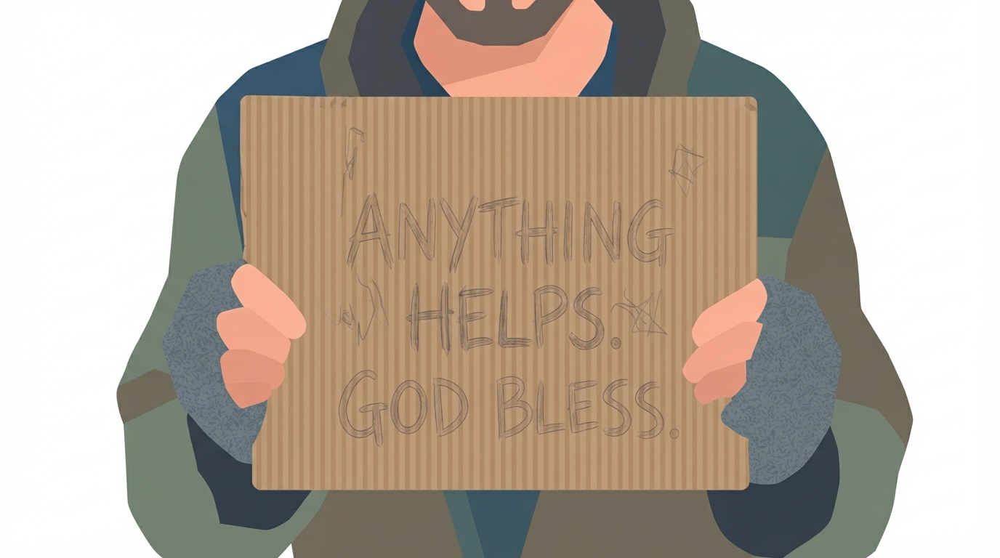
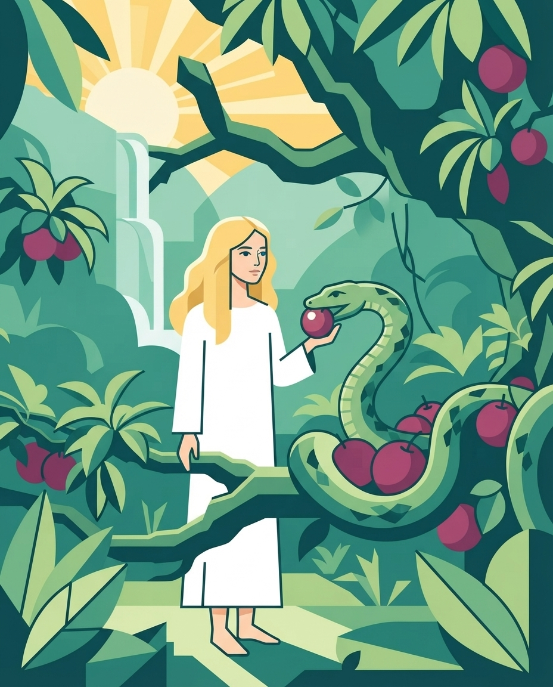
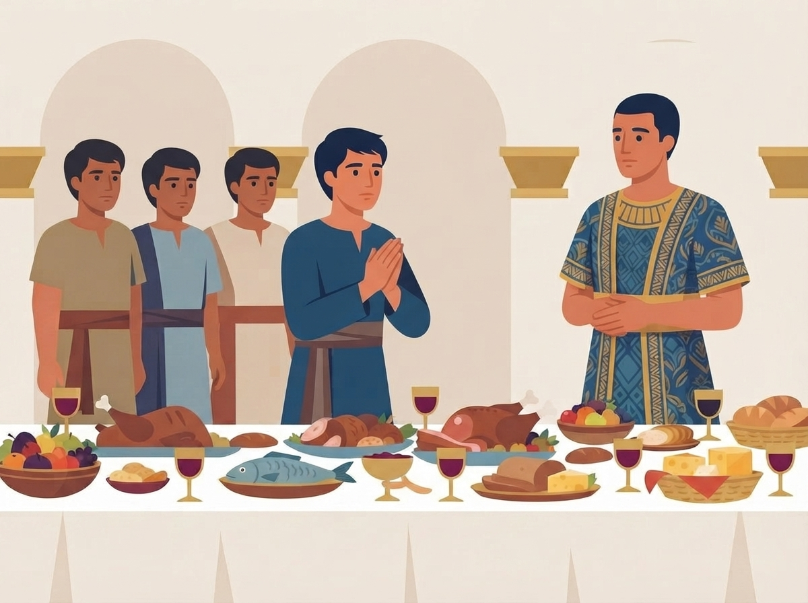
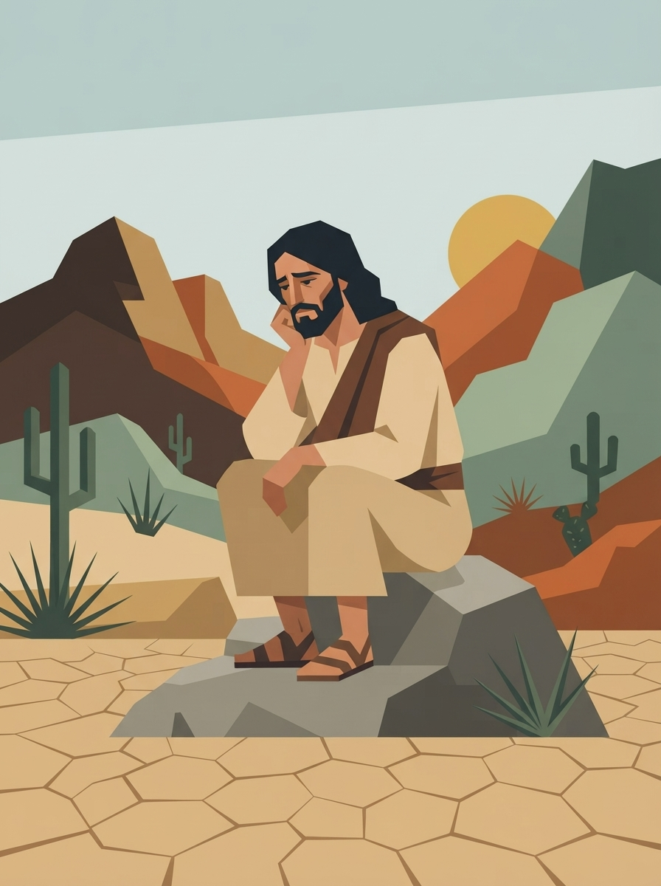

# Hunger and Thirst

Matthew 5:6

>[6] Blessed are those who hunger and thirst for righteousness, for they shall be filled.

---

# A Divine Appointment

:note:

My wife, Nina, and I had dropped our children off with their grandparents and set out to celebrate our 9th wedding anniversary. I had made reservations at a local restaurant, but with a little extra time on our hands, Nina wanted to stop by her favorite 2nd hand clothing store

I dropped her off at the entrance and searched for a place to park. It was a busy day in that area, but I managed to find a spot and pulled in—directly in front of a man sitting on the pavement. He had a ragged appearance and held a cardboard sign.

---

:note:

The moment my car stopped, he flipped up his small cardboard sign. The handwriting was not quite legible, but I was able to make out a few words about the love of God.

My faith as a Christian was being challenged right there. After all, Jesus tells us

---

# Matthew 25:40 

 >[40] Assuredly, I say to you, inasmuch as you did it to one of the least of these My brethren, you did it to Me.

---

:note:

So I purposed in my heart to share the love of God with him. I searched my vehicle and my pockets, but found no cash—not even loose change. So I stepped out of the car and was completely honest: *"I have no cash, but what can I do for you?"*

He looked up and answered that he simply needed food and water. He gave me a specific list of items I could purchase for him across the street at the grocery store. I went over to get my wife, and right as we were walking, my phone rang. The restaurant called to explain a system glitch: my reservation had been booked before their actual opening time, so they asked if we could come fifteen minutes later. We had the exact amount of time needed to go to the grocery store. Now you understand why I call this a divine appointment.

As I reviewed the man’s list, I felt an internal conflict. He had requested turkey deli meat and cheese, explaining that his teeth were virtually gone and he could no longer chew hard foods.

Being transparent with you, I had recently committed myself to a vegetarian, and plant based diet. And I have many good reasons for doing this - and these are not the point of the message today. But standing before me was this man—hungry and thirsty. I'd like to pause the story here - we're going to come back to it.

---

# Hunger & Thirst: three bible stories

- Eve and the Serpant (Genesis 3)
- Daniel and his Friends  (Daniel 1)
- Jesus in the Desert (Matthew 4)

:note:

Throughout Scripture, food and drink—hunger and thirst—are closely linked to our spirituality. Consider three stories in the Bible :

- **Adam and Eve in the Garden** (Genesis 3)
  
- **Daniel and his Friends in Babylon** (Daniel 1)
  
- **Jesus in the Desert** (Matthew 4)

---

# Eve and the Serpant

---

# Genesis 3:6
>[6] So when the woman saw that the tree was good for food, that it was pleasant to the eyes, and a tree desirable to make one wise, she took of its fruit and ate. She also gave to her husband with her, and he ate.

:note:

Right before Eve partook of the fruit, there was a pleasing effect - it was pleasant to the eyes. you have ever heard the term "eat with your eyes"? It means the visual of food influences your appetite, how much you enjoy it, and how much you eat. It's why people take pictures of their food right before they eat. Even I am guilty of this. The camera eats first? This is a very natural thing. It's because food creates strong emotions. Joy. Comfort. Nostalgia. These are all in-the moment feelings, but there are also lasting feelings. For example, food security is something many in this world do not get to experience. I grew up here in the US, and while I did experience rough times, I always had food to eat - praise God. This is not the case for many in the world where food is scarce. So you can see how having that security gives you peace of mind. Sadly, for Eve, she was deceived into a false sense of security, which lead her to doubt and disobey God.

---

# Daniel and His Friends

:note:

The next example is Daniel and his Friends. I find this story very powerful. Daniel had many reasons to turn his back on his faith. His country was just invaded by Babylon. His home destroyed. His loved ones lost. Taken captive, and enslaved. It also says He was also under chief of the eunuchs, so we beleive He was made a Eunich. But amidst all of that, he decided to honor God's principles of health

---

# Daniel 1:8
>[8] But Daniel purposed in his heart that he would not defile himself with the portion of the king’s delicacies, nor with the wine which he drank; therefore he requested of the chief of the eunuchs that he might not defile himself.

---

# Three Principles of Flesh Foods

- No blood OR fat (Genesis 9:3–4, Lev. 7:22)
- Clean vs. unclean (Lev. 11, Deut. 14)
- No food offered to idols (Num. 25, Rev. 2:14)

:note:

At that time, the children of Israel were permitted to eat flesh meats, provided three principles were met:

- no blood (Genesis 9:3–4)
  
- distinguishing clean from unclean (Leviticus 11, Deuteronomy 14)
  
- and abstaining from food offered to idols (Numbers 25, Rev. 2:14)
  

So Daniel could have chosen to be proactive in asking questions - "Is this clean?" "Was this. But Daniel and his friends chose to go a step further.

---

# Daniel 1:12:

>[12] Please test your servants for ten days, and let them give us vegetables (pulse) to eat and water to drink.

:note:

Some versions say vegetables, some say pulse. Pulse is an old word, but it includes legumes, nuts, and seeds. Effectively, going back to the standard of diet before sin entered the world. I don't know about you, but I am ready for a world without sin.

By purposing in his heart not to defile himself and choosing a simple plant-based diet, Daniel and his companions proved ten times wiser than all the wise men of Babylon. Keep in mind, these are just teenagers.

---

# Jesus in the wilderness

---

# Matthew 4:1–4:

> [1] Then Jesus was led up by the Spirit into the wilderness to be tempted by the devil [2] And when He had fasted forty days and forty nights, afterward He was hungry.

---

# Matthew 4:1–4:

>[3] Now when the tempter came to Him, he said, "If You are the Son of God, command that these stones become bread." [4] But He answered and said, "It is written, 'Man shall not live by bread alone, but by every word that proceeds from the mouth of God.'"

:note:

I want you to put yourself in the shoes of Jesus.

We see Jesus was in the middle of a fast. Fasting is a powerful tool. I listened recently to an interview with a medical doctor who treats diabetes and heart disease, and he specifically stated: *"The body was designed to fast."* This doctor is not a Christian, so he probably did not grasp the full weight of his words: *design* points to a *Designer*! Under proper guidance, science has shown fasting cleanses the body of toxins. And there are many examples in Scripture of fasting with prayer.

Another interesting thing is Jesus is extremely weak, not having food for so long puts you on the brink of death. Jesus refuses the bread and then proceeds to endure further temptation. Can you imagine? you've fasted to the brink of death and still turning away food. Then, every temptation that followed Jesus responds with Scripture. Though his body was weak, his mind was afresh with the word of God. What an incredible example Jesus has left us to follow.

---

# A Pattern in Scripture

:note:

Let's take a step back for a moment. Notice the pattern in Scripture around appetite: the very first temptation in the Garden of Eden, the first test of Daniel in Babylon, and the first temptation of Jesus in the wilderness. In each instance, Satan uses the channel of appetite when these individuals were vulnerable - seperated, captured, even on the brink of death. So what does it mean for us today?

---

# The Great Controversy p.519:

> "Satan sees the Lord’s servants burdened because of the spiritual darkness that enshrouds the people. He hears their earnest prayers for divine grace and power to break the spell of indifference, carelessness, and indolence. Then with renewed zeal he plies his arts. He tempts men to the __indulgence of appetite__ or to some other form of self-gratification, and thus benumbs their sensibilities so that they fail to hear the very things which they most need to learn."

:note:

Satan tempts us to indulge the appetite so that our sensibilities become numb and we fail to hear God's voice. I find this very interesting because many find comfort in food or drink, and I do believe God designed food to be enjoyed, but when enjoyment comes at the cost of our health or our spirituality, can we go too far?

Does God care about what we put into our bodies?

---

# 1 Corinthians 3:16–17:

> [16] Do you not know that you are the temple of God and that the Spirit of God dwells in you? [17] If anyone defiles the temple of God, God will destroy him. For the temple of God is holy, which temple you are.

:note:

There is a story in the old testament. You can find it 2 Kings 21. King Manessah of Judah was a wicked king and decided to put alters and graven statues of false gods in the sanctuary. And he did many other things defiling God's temple. So what did God do? God responded through a prophet saying God would destroy Jerasulem and give the Israelites into the hands of their enemies. And that is exactly what happened. Babylon invaded and Jersalem fell.

The principle here is simple. You reap what you sow. There is cause and effect. If we bring things into our bodies (Our bodies are God's temple) that are couterproductive to health - our health will decline. Now as it pertains to health, I would never use Scipture to judge anybody. I am no judge. In my work I travel all over the world meeting with all kinds of people who eat and drink all kinds of things - and I never think less of them because of it. Why do you think that is? because all of us(myself included) our righteousness is as filthy rags. I do not believe in salvation by works. We are not saved by our diet, we are only saved by faith through grace. However, we would be remiss not to hear what God requires of those who love Him. What I'm talking about is the difference between legalism and saving faith. In legalism one pursues holiness because he thinks it saves him - it's selfishly motivated. Saving faith on the other hand pursues holiness out of love for God. It is motivated by love!

A common misconception out there is that Seventh Day Adventists are the diet police. This is far from the truth. Our primary duties are loving God and loving our fellow man. To show people how good God is - taste and see that the Lord is good!

So you remember my story. about the homeless man. How did I respond to the request for meat and cheese? I gave him exactly what he asked for. And a little more. Some money for the bus. And a card with link to the great controversy. Spiritual food with the physical food. When I came back to him, he said I was the 6th or 7th person that he spoke to that day, but the only one that came back. He couldn't believe it. And he was so thankful he gave me a hug and kiss on the cheek. I was slightly taken aback. But I'm glad I could share God's love with Him. And I am forever changed by this interaction.

---

# Romans 12:1–2:

> [1] I beseech you therefore, brethren, by the mercies of God, that you present your bodies a living sacrifice, holy, acceptable to God, which is your reasonable service. [2] And do not be conformed to this world, but be transformed by the renewing of your mind, that you may prove what is that good and acceptable and perfect will of God.

:note:

As God's servants, presenting our bodies holy before Him is not legalistic by any means but our *"reasonable service."*

How we treat the body temple determines whether our minds remain sharp like Daniel and his friends - like Jesus in the desert. The main goal of health reform is to have the clarity of mind that welcomes the Holy Spirit. There is the added benefit of a long life. But this is not the motivation. See hoping to live longer on its own is really a self-serving pursuit. Self preservation. But there is no point in living a long live, if you've not surrendered your heart to God. If you have not experienced daily dying to self.

---

# "In times of peace prepare for war"

:note:

I thoroughly believe that our time on this Earth is very short. The Word of God cannot fail. Each day is one day closer to the great reset of our planet as we know it. One day closer to seeing Jesus coming through the clouds. Right now, we live in a time of great privelege, having all the truths of Old Testament, New Testament, and the Spirit of Prophecy. Living in a country of great wealth and at a time of great technological innovation. Let's not fall asleep in these comfortable times. A great conflict - a time of trouble - is before us, Scripture tells us global catastrophe, famine, pestilence, wars, such that all life on earth will cease. The 3rd angels message of Revelation warns us also, against coerced worship through the mark of the beast. Without the mark, we won't be able to buy or sell - how are you going to buy your groceries? We will be faced with a decision: Submit to God and suffer persecution, or submit to false worship and have food on your table.

So how do we prepare? Do we stockpile up food and water in our pantries to survive? No, we prepare our hearts. Afflict our souls. We prepare for times of hunger by being hungry now. But not hunger of food, but of the righteousness of Jesus. Blessed are those who hunger and thirst for righteousness, for they shall be filled.

---

# John 6:35

> [35] 'And Jesus said to them, “I am the bread of life. He who comes to Me shall never hunger, and he who believes in Me shall never thirst. '

:note:

I want you to memorize this text here, the words of Jesus:

---

# Testimonies for the Church, v9 p.153

> "Those who have received instruction regarding the evils of the use of flesh foods, tea and coffee, and rich and unhealthful food preparations, and who are determined to make a covenant with God by sacrifice, will not continue to indulge their appetite for food that they know to be unhealthful. God demands that the appetites be cleansed, and that self-denial be practiced... This is a work that will have to be done before His people can stand before Him a perfected people."

:note:

So I want to encourage our churches toward health reform, as it is not just a means for a long life, but it prepares you for the end of time.

---

# Revelation 7:13–17
>[13] Then one of the elders answered, saying to me, "Who are these arrayed in white robes, and where did they come from?"[14] And I said to him, "Sir, you know." So he said to me, "These are the ones who come out of the great tribulation, and washed their robes and made them white in the blood of the Lamb.

:note:

[13] Then one of the elders answered, saying to me, "Who are these arrayed in white robes, and where did they come from?"[14] And I said to him, "Sir, you know." So he said to me, "These are the ones who come out of the great tribulation, and washed their robes and made them white in the blood of the Lamb.
[15] Therefore they are before the throne of God, and serve Him day and night in His temple. And He who sits on the throne will dwell among them.
[16] They shall neither hunger anymore nor thirst anymore; the sun shall not strike them, nor any heat;
[17] for the Lamb who is in the midst of the throne will shepherd them and lead them to living fountains of waters. And God will wipe away every tear from their eyes.

---

# Revelation 7:13–17 cont.

>[15] Therefore they are before the throne of God, and serve Him day and night in His temple. And He who sits on the throne will dwell among them. [16] They shall neither hunger anymore nor thirst anymore; the sun shall not strike them, nor any heat; [17] for the Lamb who is in the midst of the throne will shepherd them and lead them to living fountains of waters. And God will wipe away every tear from their eyes.

:note:

[13] Then one of the elders answered, saying to me, "Who are these arrayed in white robes, and where did they come from?"[14] And I said to him, "Sir, you know." So he said to me, "These are the ones who come out of the great tribulation, and washed their robes and made them white in the blood of the Lamb.
[15] Therefore they are before the throne of God, and serve Him day and night in His temple. And He who sits on the throne will dwell among them.
[16] They shall neither hunger anymore nor thirst anymore; the sun shall not strike them, nor any heat;
[17] for the Lamb who is in the midst of the throne will shepherd them and lead them to living fountains of waters. And God will wipe away every tear from their eyes.